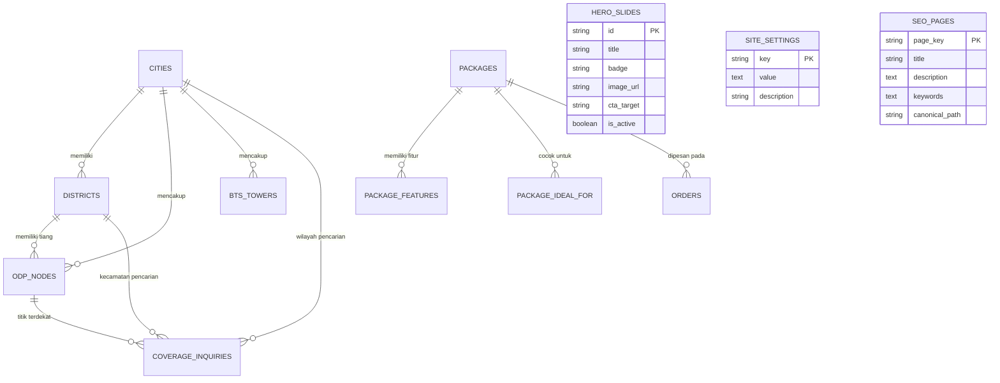

# 📄 Dokumentasi Spesifikasi REST API & Skema Database
**Proyek:** XL SATU Medan & Binjai  
**Kategori:** Web Application & Integration Architecture  
**Versi:** 1.0.0  
**Tanggal:** 23 Agustus 2026  

---

## 1. 📌 Ringkasan Arsitektur

Dokumen ini menyajikan rancangan teknis transisi aplikasi **XL SATU Medan & Binjai** dari sistem *static data* frontend ke arsitektur *Decoupled / Client-Server* berbasis **REST API** dan **Relational Database (MySQL / PostgreSQL)**.

### Komponen Utama:
1. **Frontend Client**: React + Vite (Aplikasi Landing Page, Katalog Paket, Peta ODP, dan Formulir Pendaftaran).
2. **REST API Backend**: Framework Backend (seperti Laravel, Node.js/Express, atau FastAPI).
3. **Database Engine**: Relational DB dengan dukungan Geospasial untuk menghitung titik ODP & BTS terdekat.

---

## 2. 🗺️ Entity Relationship Diagram (ERD)



---

## 3. 🗄️ Skema Database Lengkap (SQL DDL)

Berikut adalah DDL SQL siap pakai yang telah disesuaikan dengan tipe data dan aturan integritas relasional:

```sql
-- ==========================================================
-- 1. TABEL PAKET & DETAIL PRODUK
-- ==========================================================

CREATE TABLE packages (
    id VARCHAR(50) PRIMARY KEY, -- e.g. 'fiber-250', 'fwa-premium'
    name VARCHAR(150) NOT NULL, -- e.g. '250 Mbps Internet 1 Bulan'
    type ENUM('Fiber', 'FWA') NOT NULL DEFAULT 'Fiber',
    base_speed VARCHAR(50) NULL, -- '100 Mbps' (kecepatan awal sebelum booster)
    speed VARCHAR(50) NOT NULL, -- '250 Mbps' atau 'Up to 30 Mbps'
    speed_booster BOOLEAN NOT NULL DEFAULT FALSE,
    speed_level INT DEFAULT 3, -- 1-7 (level bar kecepatan visual)
    max_level INT DEFAULT 7,
    original_price DECIMAL(12,2) NULL, -- 269000.00
    promo_price DECIMAL(12,2) NOT NULL, -- 229000.00
    tax_price DECIMAL(12,2) NOT NULL, -- 254190.00 (PPN 11%)
    period VARCHAR(30) DEFAULT '/bulan*',
    badge VARCHAR(50) NULL, -- 'Paling Populer', 'Best Seller FWA'
    is_popular BOOLEAN DEFAULT FALSE,
    is_active BOOLEAN DEFAULT TRUE,
    sort_order INT DEFAULT 0,
    created_at TIMESTAMP DEFAULT CURRENT_TIMESTAMP,
    updated_at TIMESTAMP DEFAULT CURRENT_TIMESTAMP ON UPDATE CURRENT_TIMESTAMP
);

CREATE TABLE package_features (
    id BIGINT AUTO_INCREMENT PRIMARY KEY,
    package_id VARCHAR(50) NOT NULL,
    feature_text VARCHAR(255) NOT NULL,
    sort_order INT DEFAULT 0,
    FOREIGN KEY (package_id) REFERENCES packages(id) ON DELETE CASCADE
);

CREATE TABLE package_ideal_for (
    id BIGINT AUTO_INCREMENT PRIMARY KEY,
    package_id VARCHAR(50) NOT NULL,
    tag_name VARCHAR(100) NOT NULL, -- 'Browsing', 'Game Online', 'Streaming 4K'
    sort_order INT DEFAULT 0,
    FOREIGN KEY (package_id) REFERENCES packages(id) ON DELETE CASCADE
);

CREATE TABLE package_benefits (
    id BIGINT AUTO_INCREMENT PRIMARY KEY,
    title VARCHAR(150) NOT NULL, -- 'Gratis Biaya Pasang'
    description TEXT NOT NULL, -- 'Hemat biaya registrasi & instalasi standar sebesar Rp 500.000.'
    sort_order INT DEFAULT 0,
    is_active BOOLEAN DEFAULT TRUE
);

-- ==========================================================
-- 2. TABEL WILAYAH & INFRASTRUKTUR JARINGAN (ODP & BTS)
-- ==========================================================

CREATE TABLE cities (
    id BIGINT AUTO_INCREMENT PRIMARY KEY,
    name VARCHAR(100) UNIQUE NOT NULL, -- 'Kota Medan', 'Kota Binjai', 'Kab. Deli Serdang'
    center_lat DECIMAL(10, 7) NOT NULL,
    center_lng DECIMAL(10, 7) NOT NULL,
    zoom INT DEFAULT 12,
    badge VARCHAR(100) NULL, -- '21 Kecamatan Aktif'
    description TEXT NULL,
    sort_order INT DEFAULT 0,
    created_at TIMESTAMP DEFAULT CURRENT_TIMESTAMP
);

CREATE TABLE districts (
    id BIGINT AUTO_INCREMENT PRIMARY KEY,
    city_id BIGINT NOT NULL,
    name VARCHAR(100) NOT NULL, -- 'Medan Baru', 'Binjai Kota'
    status VARCHAR(50) DEFAULT 'Tersedia', -- 'Tersedia (Sinyal Penuh)', 'Tersedia Sebagian'
    network_type VARCHAR(50) DEFAULT 'Fiber & FWA',
    lat DECIMAL(10, 7) NOT NULL,
    lng DECIMAL(10, 7) NOT NULL,
    max_speed VARCHAR(50) DEFAULT 'Hingga 1 Gbps',
    odp_count VARCHAR(50) DEFAULT '50+ ODP',
    sub_areas JSON NULL, -- Array kelurahan: ["Kampus USU", "Padang Bulan", "Babura"]
    FOREIGN KEY (city_id) REFERENCES cities(id) ON DELETE CASCADE
);

CREATE TABLE odp_nodes (
    id VARCHAR(50) PRIMARY KEY, -- 'ODP-01'
    name VARCHAR(150) NOT NULL, -- 'Tiang ODP Fiber USU - Mansyur'
    city_id BIGINT NOT NULL,
    district_id BIGINT NULL,
    lat DECIMAL(10, 7) NOT NULL,
    lng DECIMAL(10, 7) NOT NULL,
    type VARCHAR(50) DEFAULT 'Fiber FTTH',
    status VARCHAR(50) DEFAULT 'Aktif 1 Gbps',
    available_slots INT DEFAULT 12,
    total_slots INT DEFAULT 16,
    is_active BOOLEAN DEFAULT TRUE,
    FOREIGN KEY (city_id) REFERENCES cities(id),
    FOREIGN KEY (district_id) REFERENCES districts(id)
);

CREATE TABLE bts_towers (
    id VARCHAR(50) PRIMARY KEY, -- 'BTS-01'
    name VARCHAR(150) NOT NULL,
    city_id BIGINT NOT NULL,
    lat DECIMAL(10, 7) NOT NULL,
    lng DECIMAL(10, 7) NOT NULL,
    radius_meters INT DEFAULT 3500,
    band VARCHAR(100) DEFAULT '5G / 4G+ Ultra Carrier',
    is_active BOOLEAN DEFAULT TRUE,
    FOREIGN KEY (city_id) REFERENCES cities(id)
);

-- ==========================================================
-- 3. TABEL TRANSAKSI: INQUIRY JANGKAUAN & REGISTRASI ORDER
-- ==========================================================

CREATE TABLE coverage_inquiries (
    id BIGINT AUTO_INCREMENT PRIMARY KEY,
    full_name VARCHAR(150) NOT NULL,
    whatsapp VARCHAR(30) NOT NULL,
    city_name VARCHAR(100) NOT NULL,
    district_name VARCHAR(100) NULL,
    address_details TEXT NOT NULL,
    gps_coordinates VARCHAR(100) NULL, -- 'Lat: 3.568500, Long: 98.657000'
    lat DECIMAL(10, 7) NULL,
    lng DECIMAL(10, 7) NULL,
    nearest_odp_id VARCHAR(50) NULL,
    odp_distance_meters INT NULL,
    status ENUM('new', 'contacted', 'surveyed', 'available', 'no_coverage', 'converted') DEFAULT 'new',
    admin_notes TEXT NULL,
    created_at TIMESTAMP DEFAULT CURRENT_TIMESTAMP,
    FOREIGN KEY (nearest_odp_id) REFERENCES odp_nodes(id) ON DELETE SET NULL
);

CREATE TABLE orders (
    id BIGINT AUTO_INCREMENT PRIMARY KEY,
    order_number VARCHAR(50) UNIQUE NOT NULL, -- e.g. 'ORD-20260823-001'
    package_id VARCHAR(50) NOT NULL,
    package_name VARCHAR(150) NOT NULL,
    package_price DECIMAL(12,2) NOT NULL,
    customer_name VARCHAR(150) NOT NULL,
    whatsapp VARCHAR(30) NOT NULL,
    city VARCHAR(100) NOT NULL,
    district VARCHAR(100) NULL,
    installation_address TEXT NOT NULL,
    lat DECIMAL(10, 7) NULL,
    lng DECIMAL(10, 7) NULL,
    status ENUM('pending', 'verified', 'scheduled', 'installed', 'cancelled') DEFAULT 'pending',
    installation_date DATETIME NULL,
    assigned_technician VARCHAR(100) NULL,
    notes TEXT NULL,
    created_at TIMESTAMP DEFAULT CURRENT_TIMESTAMP,
    updated_at TIMESTAMP DEFAULT CURRENT_TIMESTAMP ON UPDATE CURRENT_TIMESTAMP,
    FOREIGN KEY (package_id) REFERENCES packages(id)
);

-- ==========================================================
-- 4. TABEL MARKETING, SLIDES, DAN KONTEN WEBSITE
-- ==========================================================

CREATE TABLE hero_slides (
    id VARCHAR(50) PRIMARY KEY, -- 'slide-1'
    title VARCHAR(255) NOT NULL,
    badge VARCHAR(100) NOT NULL,
    image_url VARCHAR(255) NOT NULL,
    image_alt VARCHAR(255) NOT NULL,
    tab_label VARCHAR(100) NOT NULL,
    primary_cta_target VARCHAR(50) DEFAULT 'paket',
    is_nav BOOLEAN DEFAULT TRUE,
    sort_order INT DEFAULT 0,
    is_active BOOLEAN DEFAULT TRUE
);

CREATE TABLE site_settings (
    `key` VARCHAR(50) PRIMARY KEY, -- 'sales_whatsapp', 'office_address', 'social_media'
    `value` TEXT NOT NULL,
    description VARCHAR(255) NULL
);

CREATE TABLE seo_pages (
    page_key VARCHAR(50) PRIMARY KEY, -- 'home', 'paket', 'fwa', 'coverage'
    title VARCHAR(255) NOT NULL,
    description TEXT NOT NULL,
    keywords TEXT NOT NULL,
    canonical_path VARCHAR(100) NOT NULL,
    og_image VARCHAR(255) NULL
);

-- INDEXES UNTUK OPTIMASI PERFORMA GEOSPASIAL & PENCARIAN CEPAT
CREATE INDEX idx_packages_type ON packages(type, is_active);
CREATE INDEX idx_districts_city ON districts(city_id);
CREATE INDEX idx_odp_coords ON odp_nodes(lat, lng);
CREATE INDEX idx_bts_coords ON bts_towers(lat, lng);
CREATE INDEX idx_orders_status ON orders(status, created_at);
```

---

## 4. 🔌 Spesifikasi RESTful API Endpoints

Semua endpoint publik menggunakan prefix standar: `/api/v1/`.

### 📦 A. Packages & Catalog

#### 1. `GET /api/v1/packages`
Mengambil daftar paket internet fiber dan/atau FWA.
* **Query Parameters:**
  * `type` (*optional*): `Fiber` | `FWA`
  * `popular_only` (*optional*): `true` | `false`
* **Response `200 OK`:**
```json
{
  "success": true,
  "data": [
    {
      "id": "fiber-250",
      "name": "250 Mbps Internet 1 Bulan",
      "type": "Fiber",
      "baseSpeed": "100 Mbps",
      "speed": "250 Mbps",
      "speedBooster": true,
      "speedLevel": 3,
      "maxLevel": 7,
      "originalPrice": 269000,
      "promoPrice": 229000,
      "taxPrice": 254190,
      "period": "/bulan*",
      "badge": "Paling Populer",
      "isPopular": true,
      "idealFor": [
        "Browsing",
        "Sosial Media",
        "Streaming 4K",
        "Game Online"
      ],
      "features": [
        "Kecepatan hingga 250 Mbps (Speed Booster)",
        "Hingga 10 Perangkat Sekaligus",
        "Gratis Biaya Pemasangan & Instalasi",
        "Termasuk Router Wi-Fi Dual Band",
        "Bonus Kuota HP Sekeluarga 25 GB",
        "Bebas Kuota FUP (Unlimited)"
      ]
    }
  ]
}
```

#### 2. `GET /api/v1/packages/{id}`
Mengambil data detail satu paket tertentu.

#### 3. `GET /api/v1/package-benefits`
Mengambil daftar fasilitas garansi pemasangan untuk halaman katalog paket.

---

### 📍 B. Coverage, ODP, BTS & Geolocation

#### 1. `GET /api/v1/coverage/areas`
Mengambil daftar Kota, Kecamatan, dan Kelurahan untuk selector wilayah.
* **Response `200 OK`:**
```json
{
  "success": true,
  "data": [
    {
      "city": "Kota Medan",
      "center": [3.5952, 98.6722],
      "zoom": 12,
      "badge": "21 Kecamatan Aktif",
      "description": "Pusat jaringan Fiber Optik FTTH XL SATU & BTS 5G/4G+ terlengkap di Kota Medan.",
      "districts": [
        {
          "id": 1,
          "name": "Medan Baru",
          "status": "Tersedia (Sinyal Penuh)",
          "type": "Fiber & FWA",
          "lat": 3.5719,
          "lng": 98.6548,
          "speed": "Hingga 1 Gbps",
          "odpCount": "110+ ODP",
          "subAreas": ["Jl. Dr. Mansyur", "Kampus USU", "Padang Bulan", "Babura"]
        }
      ]
    }
  ]
}
```

#### 2. `GET /api/v1/coverage/nodes`
Mengambil marker titik ODP dan BTS untuk dirender pada peta Leaflet.
* **Query Parameters:** `type` = `odp` | `bts` | `all`

#### 3. `POST /api/v1/coverage/check-nearest`
Menghitung jarak terdekat ke tiang ODP dan BTS berdasarkan koordinat GPS pengguna.
* **Request Body:**
```json
{
  "lat": 3.5685,
  "lng": 98.6570
}
```
* **Response `200 OK`:**
```json
{
  "success": true,
  "data": {
    "city": "Kota Medan",
    "district": "Medan Baru",
    "districtDistanceKm": 0.42,
    "nearestOdp": {
      "id": "ODP-01",
      "name": "Tiang ODP Fiber USU - Mansyur",
      "status": "Aktif 1 Gbps",
      "slots": "12/16 Tersedia",
      "distanceMeters": 38
    },
    "coverageStatus": "AVAILABLE",
    "recommendation": "Fiber FTTH Super Cepat (Tiang ODP < 150 meter)"
  }
}
```

#### 4. `POST /api/v1/coverage/inquiry`
Menyimpan data formulir pengecekan coverage dari pengguna ke database.
* **Request Body:**
```json
{
  "fullName": "Budi Pratama",
  "whatsapp": "081234567890",
  "cityName": "Kota Medan",
  "districtName": "Medan Baru",
  "addressDetails": "Jl. Dr. Mansyur No. 45, dekat Pintu 1 USU",
  "gpsCoordinates": "Lat: 3.568500, Long: 98.657000",
  "lat": 3.568500,
  "lng": 98.657000
}
```
* **Response `201 Created`:**
```json
{
  "success": true,
  "message": "Inquiry berhasil disimpan. Tim sales akan segera memverifikasi ketersediaan ODP.",
  "inquiryId": 108
}
```

---

### 📝 C. Orders & Registrasi Pelanggan

#### 1. `POST /api/v1/orders`
Menyimpan pendaftaran pemasangan paket baru dari modal order.
* **Request Body:**
```json
{
  "packageId": "fiber-250",
  "customerName": "Muhammad Rizky",
  "whatsapp": "081298765432",
  "city": "Kota Medan",
  "installationAddress": "Jl. Ringroad No. 88, Kec. Medan Sunggal",
  "notes": "Pemasangan mohon di jadwalkan hari Sabtu"
}
```
* **Response `201 Created`:**
```json
{
  "success": true,
  "message": "Pendaftaran berhasil dibuat.",
  "data": {
    "orderNumber": "ORD-20260823-0042",
    "packageName": "250 Mbps Internet 1 Bulan",
    "promoPrice": 229000,
    "customerName": "Muhammad Rizky",
    "whatsapp": "081298765432",
    "status": "pending",
    "whatsAppRedirectUrl": "https://wa.me/6287780346500?text=..."
  }
}
```

#### 2. `GET /api/v1/orders/{orderNumber}`
Melacak status pendaftaran pelanggan (misal: `pending` -> `verified` -> `scheduled` -> `installed`).

---

### ⚙️ D. Settings, Slides & Dynamic Content

| Method | Endpoint | Deskripsi |
| :--- | :--- | :--- |
| `GET` | `/api/v1/hero-slides` | Mengambil banner slider promosi aktif |
| `GET` | `/api/v1/site-config` | Mengambil kontak WhatsApp, Call Center, dan Medsos |
| `GET` | `/api/v1/seo/{pageKey}` | Dynamic SEO metadata & JSON-LD schema (`home`, `paket`, `fwa`, `coverage`) |

---

## 5. 💻 Contoh Implementasi Integrasi Frontend React

Berikut adalah service layer `src/services/apiService.js` untuk menggantikan impor mock data lokal di React:

```javascript
// src/services/apiService.js
const API_BASE = import.meta.env.VITE_API_BASE_URL || 'http://localhost:8000/api/v1';

async function apiFetch(endpoint, options = {}) {
  const response = await fetch(`${API_BASE}${endpoint}`, {
    headers: {
      'Content-Type': 'application/json',
      'Accept': 'application/json',
      ...options.headers
    },
    ...options
  });

  const data = await response.json();
  if (!response.ok) {
    throw new Error(data.message || 'Terjadi kesalahan pada server');
  }
  return data;
}

// 1. Ambil Katalog Paket
export const getPackages = (type = '') => {
  return apiFetch(type ? `/packages?type=${type}` : '/packages');
};

// 2. Ambil Area Coverage & Titik ODP
export const getCoverageAreas = () => {
  return apiFetch('/coverage/areas');
};

export const getCoverageNodes = () => {
  return apiFetch('/coverage/nodes');
};

// 3. Cek Jarak ODP Terdekat (Backend Haversine / Spatial Calculation)
export const checkNearestOdp = (lat, lng) => {
  return apiFetch('/coverage/check-nearest', {
    method: 'POST',
    body: JSON.stringify({ lat, lng })
  });
};

// 4. Submit Form Cek Coverage
export const submitCoverageInquiry = (formData) => {
  return apiFetch('/coverage/inquiry', {
    method: 'POST',
    body: JSON.stringify(formData)
  });
};

// 5. Submit Order Pasang Baru
export const submitOrder = (orderData) => {
  return apiFetch('/orders', {
    method: 'POST',
    body: JSON.stringify(orderData)
  });
};

// 6. Ambil Pengaturan Web & SEO
export const getSiteConfig = () => {
  return apiFetch('/site-config');
};

export const getSeoByPage = (pageKey) => {
  return apiFetch(`/seo/${pageKey}`);
};
```

---

## 6. 🛡️ Rekomendasi Keamanan & Performa Backend

1. **Spatial Queries**:
   Gunakan fungsi bawaan database spatial seperti `ST_Distance_Sphere(point(lng, lat), point(odp_lng, odp_lat))` di MySQL 8+ / PostGIS untuk pencarian tiang ODP terdekat dengan kecepatan sub-milidetik.
2. **Rate Limiting**:
   Batasi endpoint `POST /api/v1/coverage/inquiry` dan `POST /api/v1/orders` (misal maks. 5 request / menit per IP) untuk mencegah spam bot form.
3. **CORS Policy**:
   Izinkan origin domain frontend Anda (misal `https://xlsatumedanbinjai.com` dan `http://localhost:5173`).
4. **WhatsApp Automation Webhook**:
   Saat status order berubah menjadi `scheduled` atau `installed`, backend dapat mentrigger webhook WhatsApp API otomatis ke nomor pelanggan.
