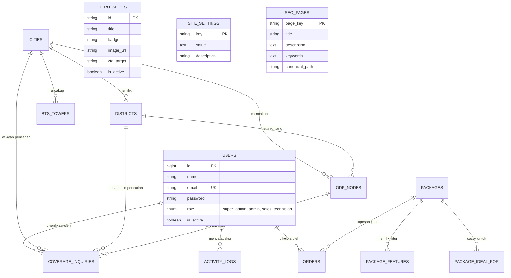

# 📄 Dokumentasi Spesifikasi REST API & Skema Database
**Proyek:** XL SATU Medan & Binjai  
**Kategori:** Web Application & Integration Architecture  
**Versi:** 1.1.0 (Ditambahkan Manajemen Pengguna & Autentikasi Admin CMS)  
**Tanggal:** 23 Agustus 2026  

---

## 1. 📌 Ringkasan Arsitektur

Dokumen ini menyajikan rancangan teknis transisi aplikasi **XL SATU Medan & Binjai** dari sistem *static data* frontend ke arsitektur *Decoupled / Client-Server* berbasis **REST API** dan **Relational Database (MySQL / PostgreSQL)**, lengkap dengan sistem manajemen konten (CMS) berbasis hak akses Admin.

### Komponen Utama:
1. **Frontend Client (Public)**: React + Vite (Landing Page, Katalog Paket, Peta ODP, Form Cek Coverage & Modal Registrasi).
2. **Admin Dashboard (CMS)**: Panel Admin untuk kelola paket, titik ODP/BTS, banner slider, kontak, dan memproses order/inquiry pelanggan.
3. **REST API Backend**: Framework Backend (Laravel / Express.js / FastAPI) dengan autentikasi berbasis Bearer Token (Sanctum / JWT).
4. **Database Engine**: Relational DB dengan dukungan Geospasial untuk menghitung titik ODP & BTS terdekat.

---

## 2. 🗺️ Entity Relationship Diagram (ERD)



---

## 3. 🗄️ Skema Database Lengkap (SQL DDL)

Berikut adalah DDL SQL lengkap siap pakai:

```sql
-- ==========================================================
-- 1. TABEL PENGGUNA (ADMIN & ROLE MANAGEMENT)
-- ==========================================================

CREATE TABLE users (
    id BIGINT AUTO_INCREMENT PRIMARY KEY,
    name VARCHAR(100) NOT NULL,
    email VARCHAR(150) UNIQUE NOT NULL,
    password VARCHAR(255) NOT NULL, -- Hashed (Bcrypt / Argon2)
    role ENUM('super_admin', 'admin', 'sales', 'technician') NOT NULL DEFAULT 'admin',
    phone VARCHAR(30) NULL,
    avatar VARCHAR(255) NULL,
    is_active BOOLEAN DEFAULT TRUE,
    last_login_at DATETIME NULL,
    remember_token VARCHAR(100) NULL,
    created_at TIMESTAMP DEFAULT CURRENT_TIMESTAMP,
    updated_at TIMESTAMP DEFAULT CURRENT_TIMESTAMP ON UPDATE CURRENT_TIMESTAMP
);

CREATE TABLE activity_logs (
    id BIGINT AUTO_INCREMENT PRIMARY KEY,
    user_id BIGINT NULL,
    action VARCHAR(100) NOT NULL, -- e.g. 'UPDATE_PACKAGE_PRICE', 'VERIFY_ORDER', 'ADD_ODP'
    description TEXT NOT NULL,
    ip_address VARCHAR(45) NULL,
    user_agent TEXT NULL,
    created_at TIMESTAMP DEFAULT CURRENT_TIMESTAMP,
    FOREIGN KEY (user_id) REFERENCES users(id) ON DELETE SET NULL
);

-- ==========================================================
-- 2. TABEL PAKET & DETAIL PRODUK
-- ==========================================================

CREATE TABLE packages (
    id VARCHAR(50) PRIMARY KEY, -- e.g. 'fiber-250', 'fwa-premium'
    name VARCHAR(150) NOT NULL, -- e.g. '250 Mbps Internet 1 Bulan'
    type ENUM('Fiber', 'FWA') NOT NULL DEFAULT 'Fiber',
    base_speed VARCHAR(50) NULL, -- '100 Mbps' (kecepatan sebelum booster)
    speed VARCHAR(50) NOT NULL, -- '250 Mbps' atau 'Up to 30 Mbps'
    speed_booster BOOLEAN NOT NULL DEFAULT FALSE,
    speed_level INT DEFAULT 3, -- 1-7 (level visual bar di UI)
    max_level INT DEFAULT 7,
    original_price DECIMAL(12,2) NULL, -- 269000.00
    promo_price DECIMAL(12,2) NOT NULL, -- 229000.00
    tax_price DECIMAL(12,2) NOT NULL, -- 254190.00 (PPN 11%)
    period VARCHAR(30) DEFAULT '/bulan*',
    badge VARCHAR(50) NULL, -- 'Paling Populer', 'Best Seller FWA'
    is_popular BOOLEAN DEFAULT FALSE,
    is_active BOOLEAN DEFAULT TRUE,
    sort_order INT DEFAULT 0,
    created_at TIMESTAMP DEFAULT CURRENT_TIMESTAMP,
    updated_at TIMESTAMP DEFAULT CURRENT_TIMESTAMP ON UPDATE CURRENT_TIMESTAMP
);

CREATE TABLE package_features (
    id BIGINT AUTO_INCREMENT PRIMARY KEY,
    package_id VARCHAR(50) NOT NULL,
    feature_text VARCHAR(255) NOT NULL,
    sort_order INT DEFAULT 0,
    FOREIGN KEY (package_id) REFERENCES packages(id) ON DELETE CASCADE
);

CREATE TABLE package_ideal_for (
    id BIGINT AUTO_INCREMENT PRIMARY KEY,
    package_id VARCHAR(50) NOT NULL,
    tag_name VARCHAR(100) NOT NULL, -- 'Browsing', 'Game Online', 'Streaming 4K'
    sort_order INT DEFAULT 0,
    FOREIGN KEY (package_id) REFERENCES packages(id) ON DELETE CASCADE
);

CREATE TABLE package_benefits (
    id BIGINT AUTO_INCREMENT PRIMARY KEY,
    title VARCHAR(150) NOT NULL, -- 'Gratis Biaya Pasang'
    description TEXT NOT NULL,
    sort_order INT DEFAULT 0,
    is_active BOOLEAN DEFAULT TRUE
);

-- ==========================================================
-- 3. TABEL WILAYAH & INFRASTRUKTUR JARINGAN (ODP & BTS)
-- ==========================================================

CREATE TABLE cities (
    id BIGINT AUTO_INCREMENT PRIMARY KEY,
    name VARCHAR(100) UNIQUE NOT NULL, -- 'Kota Medan', 'Kota Binjai', 'Kab. Deli Serdang'
    center_lat DECIMAL(10, 7) NOT NULL,
    center_lng DECIMAL(10, 7) NOT NULL,
    zoom INT DEFAULT 12,
    badge VARCHAR(100) NULL, -- '21 Kecamatan Aktif'
    description TEXT NULL,
    sort_order INT DEFAULT 0,
    created_at TIMESTAMP DEFAULT CURRENT_TIMESTAMP
);

CREATE TABLE districts (
    id BIGINT AUTO_INCREMENT PRIMARY KEY,
    city_id BIGINT NOT NULL,
    name VARCHAR(100) NOT NULL, -- 'Medan Baru', 'Binjai Kota'
    status VARCHAR(50) DEFAULT 'Tersedia', -- 'Tersedia (Sinyal Penuh)', 'Tersedia Sebagian'
    network_type VARCHAR(50) DEFAULT 'Fiber & FWA',
    lat DECIMAL(10, 7) NOT NULL,
    lng DECIMAL(10, 7) NOT NULL,
    max_speed VARCHAR(50) DEFAULT 'Hingga 1 Gbps',
    odp_count VARCHAR(50) DEFAULT '50+ ODP',
    sub_areas JSON NULL, -- Array kelurahan: ["Kampus USU", "Padang Bulan", "Babura"]
    FOREIGN KEY (city_id) REFERENCES cities(id) ON DELETE CASCADE
);

CREATE TABLE odp_nodes (
    id VARCHAR(50) PRIMARY KEY, -- 'ODP-01'
    name VARCHAR(150) NOT NULL, -- 'Tiang ODP Fiber USU - Mansyur'
    city_id BIGINT NOT NULL,
    district_id BIGINT NULL,
    lat DECIMAL(10, 7) NOT NULL,
    lng DECIMAL(10, 7) NOT NULL,
    type VARCHAR(50) DEFAULT 'Fiber FTTH',
    status VARCHAR(50) DEFAULT 'Aktif 1 Gbps',
    available_slots INT DEFAULT 12,
    total_slots INT DEFAULT 16,
    is_active BOOLEAN DEFAULT TRUE,
    FOREIGN KEY (city_id) REFERENCES cities(id),
    FOREIGN KEY (district_id) REFERENCES districts(id)
);

CREATE TABLE bts_towers (
    id VARCHAR(50) PRIMARY KEY, -- 'BTS-01'
    name VARCHAR(150) NOT NULL,
    city_id BIGINT NOT NULL,
    lat DECIMAL(10, 7) NOT NULL,
    lng DECIMAL(10, 7) NOT NULL,
    radius_meters INT DEFAULT 3500,
    band VARCHAR(100) DEFAULT '5G / 4G+ Ultra Carrier',
    is_active BOOLEAN DEFAULT TRUE,
    FOREIGN KEY (city_id) REFERENCES cities(id)
);

-- ==========================================================
-- 4. TABEL TRANSAKSI: INQUIRY JANGKAUAN & REGISTRASI ORDER
-- ==========================================================

CREATE TABLE coverage_inquiries (
    id BIGINT AUTO_INCREMENT PRIMARY KEY,
    full_name VARCHAR(150) NOT NULL,
    whatsapp VARCHAR(30) NOT NULL,
    city_name VARCHAR(100) NOT NULL,
    district_name VARCHAR(100) NULL,
    address_details TEXT NOT NULL,
    gps_coordinates VARCHAR(100) NULL,
    lat DECIMAL(10, 7) NULL,
    lng DECIMAL(10, 7) NULL,
    nearest_odp_id VARCHAR(50) NULL,
    odp_distance_meters INT NULL,
    status ENUM('new', 'contacted', 'surveyed', 'available', 'no_coverage', 'converted') DEFAULT 'new',
    handled_by_user_id BIGINT NULL, -- Admin/Sales yang memproses
    admin_notes TEXT NULL,
    created_at TIMESTAMP DEFAULT CURRENT_TIMESTAMP,
    FOREIGN KEY (nearest_odp_id) REFERENCES odp_nodes(id) ON DELETE SET NULL,
    FOREIGN KEY (handled_by_user_id) REFERENCES users(id) ON DELETE SET NULL
);

CREATE TABLE orders (
    id BIGINT AUTO_INCREMENT PRIMARY KEY,
    order_number VARCHAR(50) UNIQUE NOT NULL, -- e.g. 'ORD-20260823-001'
    package_id VARCHAR(50) NOT NULL,
    package_name VARCHAR(150) NOT NULL,
    package_price DECIMAL(12,2) NOT NULL,
    customer_name VARCHAR(150) NOT NULL,
    whatsapp VARCHAR(30) NOT NULL,
    city VARCHAR(100) NOT NULL,
    district VARCHAR(100) NULL,
    installation_address TEXT NOT NULL,
    lat DECIMAL(10, 7) NULL,
    lng DECIMAL(10, 7) NULL,
    status ENUM('pending', 'verified', 'scheduled', 'installed', 'cancelled') DEFAULT 'pending',
    installation_date DATETIME NULL,
    assigned_technician_id BIGINT NULL, -- Relasi ke user technician
    assigned_technician_name VARCHAR(100) NULL,
    handled_by_user_id BIGINT NULL, -- Admin/Sales yang memverifikasi
    notes TEXT NULL,
    created_at TIMESTAMP DEFAULT CURRENT_TIMESTAMP,
    updated_at TIMESTAMP DEFAULT CURRENT_TIMESTAMP ON UPDATE CURRENT_TIMESTAMP,
    FOREIGN KEY (package_id) REFERENCES packages(id),
    FOREIGN KEY (assigned_technician_id) REFERENCES users(id) ON DELETE SET NULL,
    FOREIGN KEY (handled_by_user_id) REFERENCES users(id) ON DELETE SET NULL
);

-- ==========================================================
-- 5. TABEL MARKETING, SLIDES, DAN KONTEN WEBSITE
-- ==========================================================

CREATE TABLE hero_slides (
    id VARCHAR(50) PRIMARY KEY, -- 'slide-1'
    title VARCHAR(255) NOT NULL,
    badge VARCHAR(100) NOT NULL,
    image_url VARCHAR(255) NOT NULL,
    image_alt VARCHAR(255) NOT NULL,
    tab_label VARCHAR(100) NOT NULL,
    primary_cta_target VARCHAR(50) DEFAULT 'paket',
    is_nav BOOLEAN DEFAULT TRUE,
    sort_order INT DEFAULT 0,
    is_active BOOLEAN DEFAULT TRUE
);

CREATE TABLE site_settings (
    `key` VARCHAR(50) PRIMARY KEY, -- 'sales_whatsapp', 'office_address', 'social_media'
    `value` TEXT NOT NULL,
    description VARCHAR(255) NULL
);

CREATE TABLE seo_pages (
    page_key VARCHAR(50) PRIMARY KEY, -- 'home', 'paket', 'fwa', 'coverage'
    title VARCHAR(255) NOT NULL,
    description TEXT NOT NULL,
    keywords TEXT NOT NULL,
    canonical_path VARCHAR(100) NOT NULL,
    og_image VARCHAR(255) NULL
);

-- INDEXES UNTUK OPTIMASI QUERY CEPAT
CREATE INDEX idx_users_email ON users(email);
CREATE INDEX idx_packages_type ON packages(type, is_active);
CREATE INDEX idx_districts_city ON districts(city_id);
CREATE INDEX idx_odp_coords ON odp_nodes(lat, lng);
CREATE INDEX idx_bts_coords ON bts_towers(lat, lng);
CREATE INDEX idx_orders_status ON orders(status, created_at);
```

---

## 4. 🔌 Spesifikasi RESTful API Endpoints

### 🔐 A. Autentikasi & Profil Admin (`/api/v1/auth/*`)

| Method | Endpoint | Kegunaan | Payload / Body |
| :--- | :--- | :--- | :--- |
| `POST` | `/api/v1/auth/login` | Login Admin CMS | `{ "email": "admin@xlsatumedan.com", "password": "secretpassword" }` |
| `POST` | `/api/v1/auth/logout` | Logout (Revoke Bearer Token) | Header: `Authorization: Bearer <token>` |
| `GET` | `/api/v1/auth/me` | Cek info user yang sedang login | Header: `Authorization: Bearer <token>` |
| `PUT` | `/api/v1/auth/profile` | Update profil user (nama, telepon, avatar) | `{ "name": "Admin Medan", "phone": "081234..." }` |
| `PUT` | `/api/v1/auth/password` | Ganti password | `{ "currentPassword": "...", "newPassword": "..." }` |

---

### 🛡️ B. Admin CMS Management Routes (`/api/v1/admin/*`)
*Semua endpoint di bawah memerlukan header `Authorization: Bearer <token>` dan hak akses role yang sesuai (`super_admin` / `admin`).*

#### 1. Manajemen Paket Internet (`/admin/packages`)
* `GET /api/v1/admin/packages` : Ambil seluruh paket (termasuk yang non-aktif).
* `POST /api/v1/admin/packages` : Tambah paket baru.
* `PUT /api/v1/admin/packages/{id}` : Update detail paket (harga promo, kuota, speed booster).
* `DELETE /api/v1/admin/packages/{id}` : Hapus atau non-aktifkan paket.

#### 2. Manajemen Jaringan & Titik Tiang ODP (`/admin/coverage`)
* `POST /api/v1/admin/odp-nodes` : Tambah titik tiang ODP baru beserta koordinat lat/lng.
* `PUT /api/v1/admin/odp-nodes/{id}` : Update slot ODP terpakai atau status tiang.
* `DELETE /api/v1/admin/odp-nodes/{id}` : Hapus titik ODP.
* `POST /api/v1/admin/bts-towers` : Tambah tower BTS baru.

#### 3. Manajemen Order & Leads Masuk (`/admin/orders` & `/admin/inquiries`)
* `GET /api/v1/admin/orders` : Filter order berdasarkan status (`pending`, `verified`, `scheduled`, `installed`).
* `PUT /api/v1/admin/orders/{id}/status` : Update status order, penugasan teknisi (`assigned_technician_id`), dan jadwal instalasi.
* `GET /api/v1/admin/coverage-inquiries` : Lihat daftar calon pelanggan yang mengecek tiang ODP.

#### 4. Manajemen Konten Website & Banner Slider (`/admin/cms`)
* `GET /api/v1/admin/hero-slides` & `POST /api/v1/admin/hero-slides` : Kelola banner slider halaman depan.
* `PUT /api/v1/admin/hero-slides/{id}` : Update urutan atau gambar slide.
* `PUT /api/v1/admin/site-settings` : Update nomor WhatsApp Sales, nomor CS, dan alamat kantor.
* `PUT /api/v1/admin/seo/{pageKey}` : Update meta title & description SEO tiap halaman.

#### 5. Manajemen Pengguna / Admin (`/admin/users`) — *Khusus Super Admin*
* `GET /api/v1/admin/users` : Daftar admin & staff.
* `POST /api/v1/admin/users` : Tambah admin/sales/teknisi baru.
* `PUT /api/v1/admin/users/{id}` : Edit role atau status aktif.
* `DELETE /api/v1/admin/users/{id}` : Hapus akun.

---

### 🌐 C. Public Endpoints (Untuk Frontend React Pelanggan)

| Method | Endpoint | Kegunaan di Frontend Client |
| :--- | :--- | :--- |
| `GET` | `/api/v1/packages` | Menampilkan paket aktif di [HomePage](file:///Users/yudi-macair/Desktop/xl-satu-medan-binjai/src/pages/HomePage.jsx) & [PaketPage](file:///Users/yudi-macair/Desktop/xl-satu-medan-binjai/src/pages/PaketPage.jsx) |
| `GET` | `/api/v1/packages/{id}` | Detail paket tertentu |
| `GET` | `/api/v1/package-benefits` | Garansi & fasilitas pemasangan |
| `GET` | `/api/v1/coverage/areas` | Daftar kota & kecamatan untuk dropdown [CoverageForm](file:///Users/yudi-macair/Desktop/xl-satu-medan-binjai/src/components/CoverageForm.jsx) |
| `GET` | `/api/v1/coverage/nodes` | Marker tiang ODP & BTS untuk peta Leaflet |
| `POST` | `/api/v1/coverage/check-nearest` | Kalkulasi otomatis ODP terdekat dari lat/lng GPS |
| `POST` | `/api/v1/coverage/inquiry` | Submit form cek jangkauan pelanggan |
| `POST` | `/api/v1/orders` | Submit form pendaftaran dari [OrderModal](file:///Users/yudi-macair/Desktop/xl-satu-medan-binjai/src/components/OrderModal.jsx) |
| `GET` | `/api/v1/hero-slides` | Slider promo aktif di halaman utama |
| `GET` | `/api/v1/site-config` | Nomor WhatsApp, Call Center, Medsos untuk footer & floating button |
| `GET` | `/api/v1/seo/{pageKey}` | Dynamic SEO meta tags & Schema.org JSON-LD |

---

## 5. 👥 Hak Akses Role Pengguna (Role-Based Access Control)

| Fitur / Modul | Super Admin | Admin CMS | Sales | Teknisi |
| :--- | :---: | :---: | :---: | :---: |
| **Kelola User & Hak Akses** | ✅ | ❌ | ❌ | ❌ |
| **Edit Harga & Paket Internet** | ✅ | ✅ | ❌ | ❌ |
| **Kelola Banner Slider & SEO** | ✅ | ✅ | ❌ | ❌ |
| **Kelola Titik Tiang ODP & BTS** | ✅ | ✅ | ❌ | ❌ |
| **Lihat & Follow-up Order Pelanggan** | ✅ | ✅ | ✅ | ❌ |
| **Update Jadwal & Status Instalasi** | ✅ | ✅ | ❌ | ✅ |
| **Lihat Riwayat Activity Logs** | ✅ | ❌ | ❌ | ❌ |
